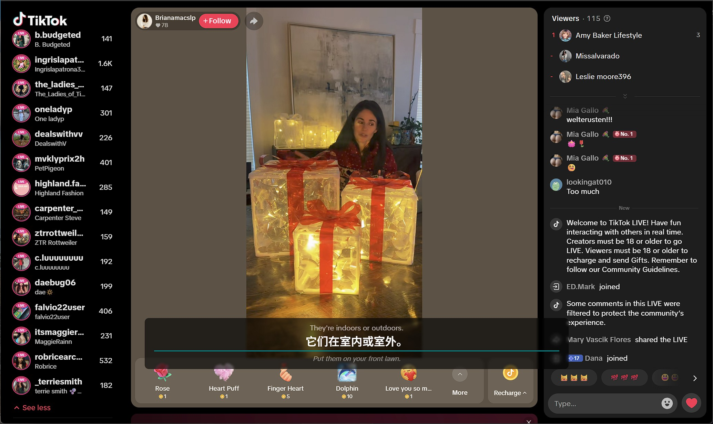
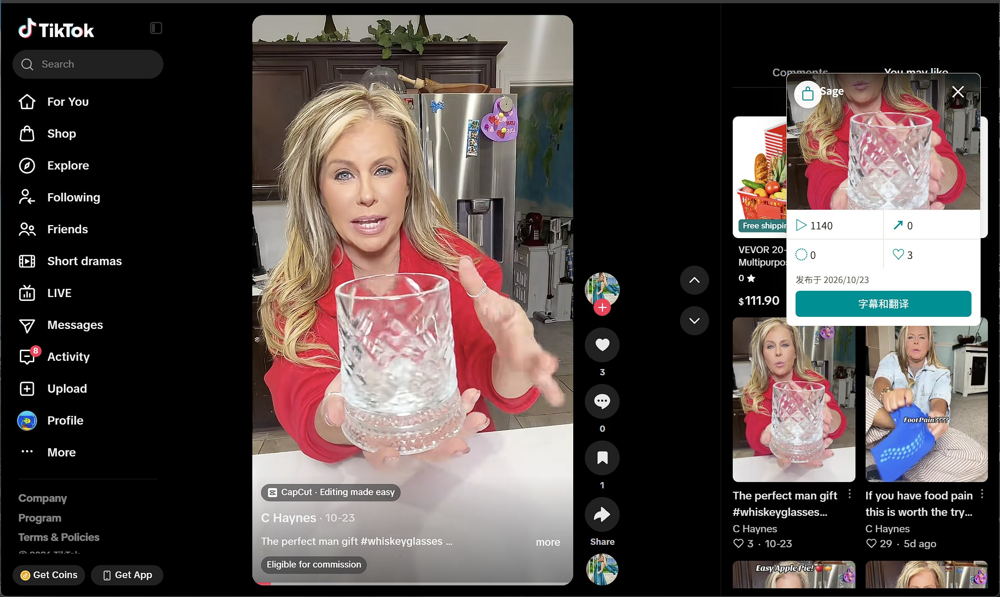
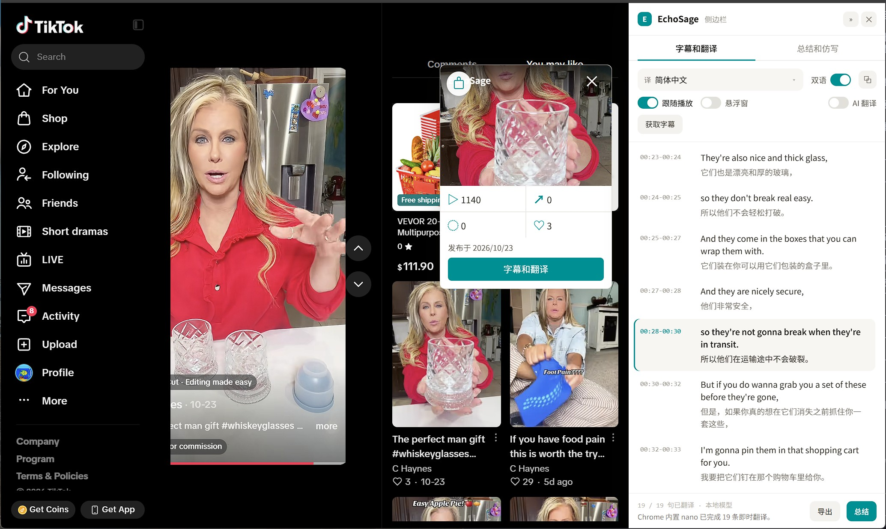
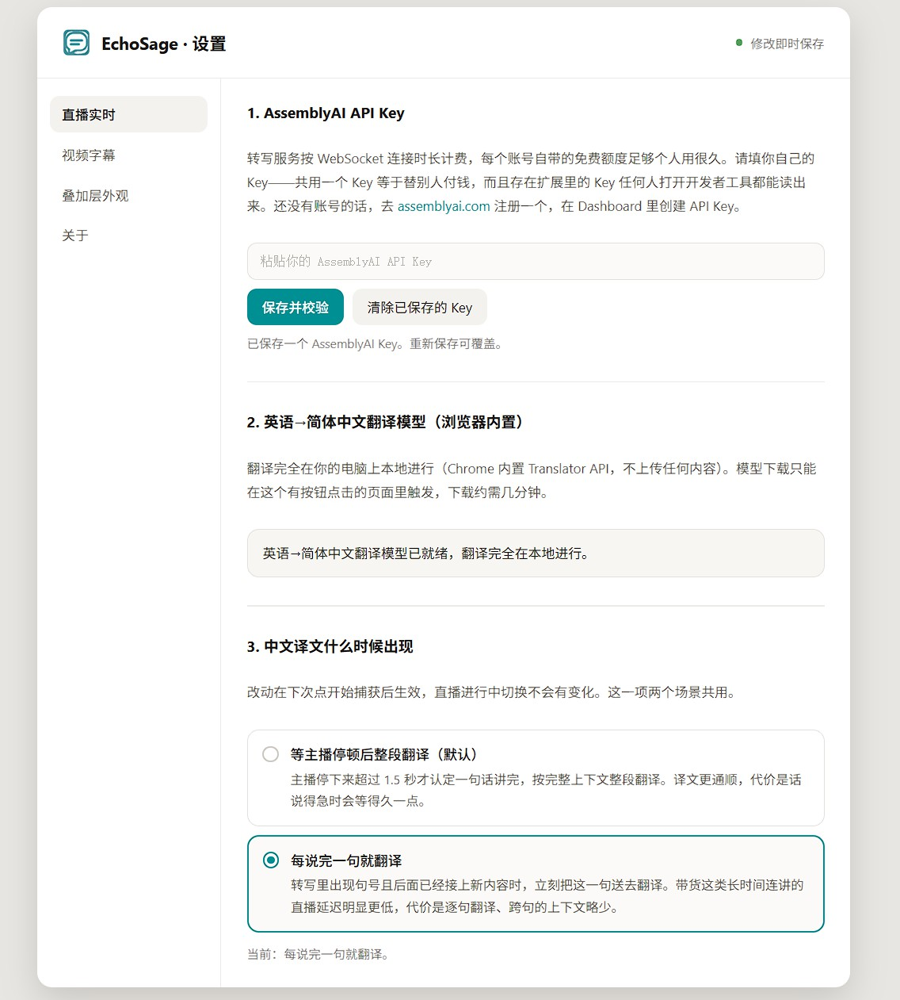
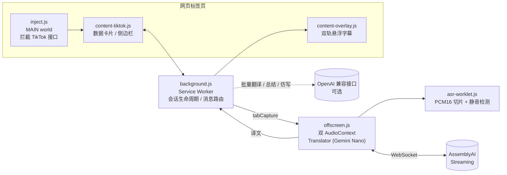

<div align="center">


# EchoSage

**听得懂任何语言的直播，看得透每一条 TikTok。**

一个 Chrome 扩展（Manifest V3）：捕获标签页音频，实时转写、端侧翻译，并以双轨字幕呈现。

[](https://github.com/Fluxwang/EchoSage/releases)
[](https://developer.chrome.com/docs/extensions/develop/migrate/what-is-mv3)
[](https://www.assemblyai.com/)
[](https://developer.chrome.com/docs/ai/translator-api)
[](LICENSE)

[功能](#-功能) · [安装](#-安装) · [使用](#-使用) · [更新](#-更新) · [开发](#-开发) · [架构](#-架构) · [隐私与权限](#-隐私与权限)



<sub>直播实时：英语直播 → 简体中文双轨悬浮字幕</sub>

</div>

---

## ✨ 功能

EchoSage 覆盖两个场景，共用「转写 → 翻译 → 字幕呈现」三层基础设施。

### 🎙️ 直播实时 · 任意网站

- **一键捕获**：`tabCapture` 捕获当前标签页音频并原样回放，不影响正常观看
- **实时流式转写**：AssemblyAI v3 Streaming，源语言可选（西 / 英 / 日 / 韩 / 法 / 德 / 葡）
- **端侧即时翻译**：Chrome 内置 Translator（Gemini Nano），译文在本机生成，不产生云端翻译费用
- **双轨悬浮字幕**：原文轨弱化、只提示活跃度，译文轨是主视觉；位置可拖动，外观可自定义
- **花钱保险丝**：静音 60 秒自动断连，单次会话最长 1 小时（[ADR-0005](docs/adr/0005-session-lifecycle-and-spend-control.md)）

### 🎬 视频字幕 · TikTok

- **原生字幕优先**：优先读取 TikTok 自带的 WebVTT 字幕轨；没有时才启用流式转写，并在视频**播完一轮后自动停止**，不会因循环播放一直计费
- **两种翻译引擎**：Chrome 内置 nano（默认，逐句即时翻译），或 AI 模型（整段批量翻译，支持任意 OpenAI 兼容接口）
- **视频数据卡片**：封面、播放 / 点赞 / 评论 / 分享、发布时间，带货视频可直接查看关联商品
- **侧边栏工作区**：
  - 📜 完整字幕列表：跟随播放高亮、双语对照、一键导出 `.txt`
  - 🧠 视频要点总结
  - ✍️ 按口播时长 / 类型生成仿写脚本

### 🧩 共享能力

- 一个工具栏图标、一个 popup（「直播实时」/「视频字幕」两个 Tab）、一份设置
- 译文语言可选：简体中文（默认）/ 繁体中文 / 英语 / 日语
- 译文触发时机可调：**停顿模式**或**句子模式**（[ADR-0007](docs/adr/0007-sentence-level-translate-trigger.md)）
- 内置更新检查：有新版本时工具栏显示红色角标

## 📸 截图

<table>
  <tr>
    <td align="center" width="50%"><br><sub>TikTok 数据卡片：播放 / 分享 / 评论 / 点赞 + 带货商品入口</sub></td>
    <td align="center" width="50%"><br><sub>侧边栏：跟随播放高亮的双语字幕列表</sub></td>
  </tr>
</table>

<p align="center">
  <br>
  <sub>设置页 · 直播实时 / 视频字幕 / 叠加层外观 / 关于</sub>
</p>

## 📦 安装

> **环境要求**：Chrome 138+（需要支持内置 [Translator API](https://developer.chrome.com/docs/ai/translator-api)），以及一个 [AssemblyAI](https://www.assemblyai.com/) API Key。

1. 克隆仓库（仓库已包含构建产物 `dist/`，**不需要安装 Node**）：

   ```sh
   git clone https://github.com/Fluxwang/EchoSage.git
   ```

2. 打开 `chrome://extensions`，开启右上角「开发者模式」
3. 点击「加载已解压的扩展程序」，选择克隆下来的仓库根目录
4. 把 EchoSage 固定到工具栏

## 🚀 使用

**首次配置**（工具栏图标 → ⚙ 设置）：

| 配置项 | 是否必需 | 说明 |
| --- | --- | --- |
| AssemblyAI API Key | ✅ 必需 | 两个场景共用一把 |
| 内置翻译模型 | ✅ 必需 | 按提示点击下载对应语言对的模型（Translator API 要求由用户点击触发） |
| AI 模型 Base URL / API Key / 模型名 | 可选 | 仅视频字幕场景的「AI 模型」翻译引擎和总结 / 仿写功能需要，任何 OpenAI 兼容的 chat completions 接口都可以 |

**直播实时**：打开任意有声音的页面 → 点击工具栏图标 →「直播实时」Tab → 开始。字幕会悬浮在页面上，可拖动位置。

**视频字幕**：打开 TikTok 视频详情页 → 页面上出现 EchoSage 数据卡片 → 点击「字幕和翻译」打开侧边栏。

## 🔄 更新

有可用更新时，工具栏图标显示红色角标，popup 品牌栏出现小红点。点击小红点进入设置页「关于」分区，按两步操作：

1. **拉取代码**
   - Windows：双击仓库根目录的 `update.bat`
   - macOS / Linux：在仓库根目录运行 `git fetch origin main && git reset --hard origin/main`
2. **重载扩展**：回到设置页点击「我已拉取，重载扩展」

> [!WARNING]
> 更新会让工作副本与远端 `main` 完全一致，被跟踪文件里的本地修改会被覆盖。角标在重载之后才会消失，而不是在拉取之后。

## 🛠 开发

```sh
npm install
npm run watch   # esbuild 增量构建，改完去 chrome://extensions 手动重新加载
npm test        # node --test 跑 core/ 与 tests/ 下的单元测试
npm run check   # build + test
```

日常 `build` / `watch` 保留 sourcemap。发布必须从干净工作区执行唯一入口（需要已登录的 `git` 与 GitHub CLI）：

```sh
npm run release -- 0.3.0
```

该命令会同步 `manifest.json`、`package.json` 与锁文件版本，执行无 sourcemap 的发版构建，提交 `dist/`，创建并推送 `v` 前缀标签，最后创建带自动生成说明的 GitHub Release。**不要手工打发布标签。**

## 🏗 架构



<details>
<summary><b>项目结构</b></summary>

```
background.js          service worker：会话生命周期、AssemblyAI 连接、消息路由
offscreen.js/.html     离屏文档：双 AudioContext（回放链路 + 转写链路）、AudioWorklet 挂载
asr-worklet.js         AudioWorklet：PCM16 切片 + RMS 静音检测
inject.js              MAIN world，document_start 打补丁 fetch/XHR 拦截 TikTok 接口响应
content-tiktok.js/.css TikTok 专属，隔离世界：数据卡片、字幕列表、商品弹层、侧边栏挂载
content-overlay.js     <all_urls>，隔离世界：双轨悬浮字幕层
popup.html/.js         紧凑视图：直播实时 / 视频字幕 两个 Tab
options.html/.js       设置页：直播实时 / 视频字幕 / 叠加层外观 / 关于
sidepanel/             视频字幕场景专属工作区：字幕列表 + 总结/仿写
shared/                跨入口公共模块，经 esbuild 打包
core/                  纯逻辑状态机（会话/音频/播放判定），不经构建，node --test 直接跑
dist/                  构建产物（刻意提交，见 ADR-0011）
docs/adr/              编号架构决策记录
CONTEXT.md             领域词汇表
.scratch/              issue / spec 文件（无远程 issue tracker）
```

`core/` 是本项目唯一的测试 seam：任何不碰浏览器 API 的状态机 / 判定逻辑都放这里，用 Node 内置 test runner 测，不 mock 浏览器全局对象。

</details>

<details>
<summary><b>关键设计决策（ADR）</b></summary>

| ADR | 决策 |
| --- | --- |
| [0001](docs/adr/0001-dual-audiocontext-playback-and-asr.md) | 双 AudioContext：回放与转写链路分离 |
| [0003](docs/adr/0003-builtin-translator-only-no-cloud-fallback.md) | 直播场景只用内置 Translator，不提供云端兜底 |
| [0005](docs/adr/0005-session-lifecycle-and-spend-control.md) | 会话生命周期与花钱保险丝 |
| [0007](docs/adr/0007-sentence-level-translate-trigger.md) | 译文触发时机：停顿 / 句子 |
| [0008](docs/adr/0008-drop-whisper-and-microsoft-translate.md) | 合并时移除 Whisper 与 Azure Translator |
| [0009](docs/adr/0009-video-scene-uses-streaming-asr-stop-at-one-playthrough.md) | 视频场景用流式转写，播完一轮即停 |
| [0010](docs/adr/0010-adopt-esbuild-for-shared-modules.md) | 引入 esbuild 打包共享模块 |
| [0011](docs/adr/0011-git-pull-distribution-and-update-check.md) | git pull 分发与更新检查 |

完整列表见 [`docs/adr/`](docs/adr/)，领域词汇见 [`CONTEXT.md`](CONTEXT.md)。

</details>

## 🔒 隐私与权限

- 所有 API Key 只保存在本机 `chrome.storage.local`，**不经过任何第三方服务器中转**
- 直播场景的翻译完全在端侧完成；音频只发送给 AssemblyAI 用于转写
- AssemblyAI 按 WebSocket 连接时长计费，AI 翻译 / 总结按你自己配置的接口计费

| 权限 | 用途 |
| --- | --- |
| `tabCapture` | 捕获当前标签页音频用于转写与回放 |
| `offscreen` | MV3 service worker 没有 `AudioContext`，转写与回放跑在离屏文档里 |
| `storage` | 保存 API Key、语言、引擎等设置 |
| `scripting` | 按需向标签页注入脚本 |
| `alarms` | 每 24 小时检查一次 GitHub 发布版本 |
| `<all_urls>` | 直播实时场景要支持任意网站；TikTok 专属逻辑靠 URL match pattern 限定 |

## 🙏 由来

EchoSage 由两个独立扩展合并而来：**EchoCap**（任意标签页的实时直播字幕）与 **TikTok Caption Studio**（TikTok 视频字幕与内容生成）。合并动机与过程见 [`.scratch/echosage-merge/spec.md`](.scratch/echosage-merge/spec.md)。

## 📄 License

[MIT](LICENSE)
